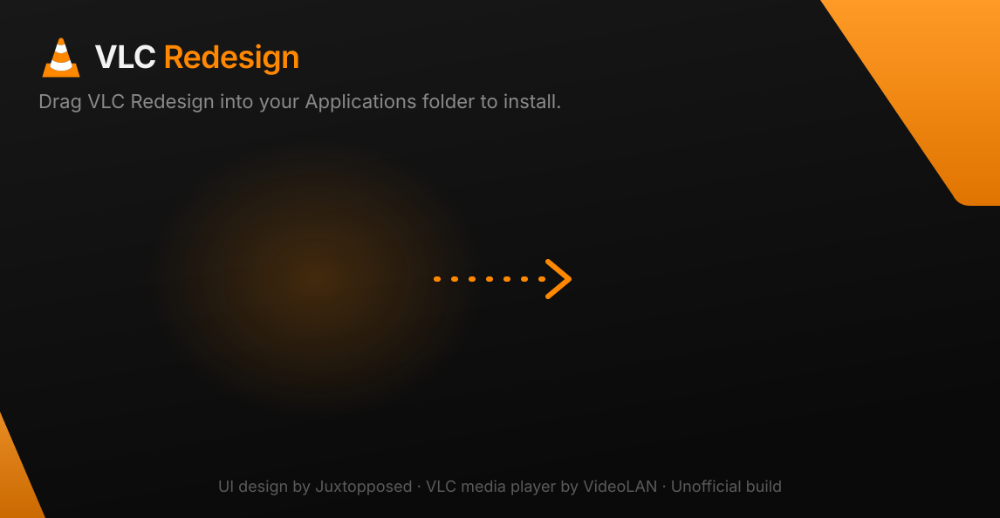
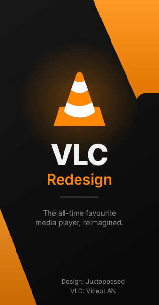

# VLC Redesign — VLC 3.0

> This is the **VLC 3.0.24 (stable)** branch. The VLC 4.0 version lives on [`master`](../../tree/master).

  

**VLC Redesign** is an unofficial fork of [VLC media player](https://www.videolan.org/vlc/)
whose interface is restyled after the design in
**[“I Redesigned VLC After 25 Years”](https://www.youtube.com/watch?v=ERFeOgqk324)
by [Juxtopposed](https://www.youtube.com/@juxtopposed)**.

> **Credits**
> - **Design:** Juxtopposed, from the video [“I Redesigned VLC After 25 Years”](https://www.youtube.com/watch?v=ERFeOgqk324).
>   Go watch it and support the channel.
> - **VLC media player:** the [VideoLAN](https://www.videolan.org) team and VLC's contributors.
>   Everything that makes this a media player is their work. This fork only changes how it looks.
>
> This project is not affiliated with or endorsed by VideoLAN or Juxtopposed.
> “VLC” and the cone logo are trademarks of the VideoLAN association.

  

## Downloads

Grab the latest installers from **[Releases](../../releases)**:

| Platform | Package |
| --- | --- |
| Windows x64 | `Setup.exe` (NSIS with the dark redesign theme) and a portable `.zip` |
| macOS Apple Silicon (arm64) | `VLC Redesign.app`, which installs itself into Applications when first opened |
| macOS Intel (x86_64) | `VLC Redesign.app`, which installs itself into Applications when first opened |
| Linux x86_64 | `.AppImage` with a setup wizard; works even where AppImageLauncher crashes |

Builds are published for both **VLC 4.0** (development, `master`) and **VLC 3.0** (stable, `redesign-3.0` branch).

All of them are built by GitHub Actions ([`.github/workflows/build.yml`](.github/workflows/build.yml)).
The builds are unsigned, so see the first-launch notes in each release.

## What's changed from upstream VLC

Interface (Qt 5 widgets, used on Windows and Linux) — VLC 3 doesn't have VLC 4's QML interface, so the redesign is applied through its theme: the redesign palette (on by default), an orange-accent stylesheet with rounded menus, buttons, tabs and scrollbars, a flat orange seek bar and volume slider, and lighter icons for the dark background.

For reference, the VLC 4.0 changes are:
- A new dark palette taken from the video: layered near-black surfaces (`#0A0A0A` → `#2F2F2F`),
  soft separators, and VLC orange (`#FF8800`) as the only accent
  ([`systempalette.cpp`](modules/gui/qt/style/systempalette.cpp)).
- Dark ("Night") is the default color scheme.
- Rounder corners on buttons, covers, nav items and the main view ([`VLCStyle.qml`](modules/gui/qt/style/VLCStyle.qml)).
- The play button is now a rounded-square orange tile with a black glyph, like in the video
  ([`PlayButton.qml`](modules/gui/qt/player/qml/controlbarcontrols/PlayButton.qml)).
- Sidebar: the current page gets an orange-tinted tile and indicator.
- Credits in *Help → About*.

macOS (native Cocoa interface):
- Always uses the dark appearance, with VLC orange as the accent instead of the system accent.
- Redesign tones for separators, slider tracks and borders; credits in *About VLC*.
- Ships as **VLC Redesign.app** with its own bundle id (`io.github.okjace.vlc-redesign`). Sparkle
  auto-update is disabled so it never "updates" itself back to official VLC.

Installers ([`redesign/branding`](redesign/branding)):
- **Windows:** dark welcome/finish pages with custom side art, a branded header and a custom welcome text
  and finish link. It installs side by side with official VLC (separate install dir, registry keys and
  Start-menu folder, and the uninstaller never touches VideoLAN's keys).
- **macOS:** like [Jace Launcher](https://github.com/okjace/jace-launcher), the download is just the `.app`. Opened
  from Downloads, it offers to copy itself into Applications, clear the quarantine flag ("damaged" warning),
  add Dock and Desktop shortcuts, and then relaunches the installed copy.
- **Linux:** like Jace Launcher, the AppImage opens a setup wizard (in the redesign style) that installs it to
  `~/Applications` with an applications-menu entry, desktop shortcut, `vlc-redesign` command and AppStream
  metadata. Launchers start it with `APPIMAGELAUNCHER_DISABLE=1`, and the AppImage magic bytes are cleared, so
  AppImageLauncher, which aborts on Wayland desktops such as niri, never intercepts it.

| DMG window | Windows installer |
| --- | --- |
|  |   |

To regenerate the artwork, run `redesign/branding/generate.py --font-dir <dir with Inter .ttf>`.

## Building locally

- Linux: `redesign/ci/build-linux.sh` (Ubuntu 24.04)
- macOS: `redesign/ci/build-macos.sh arm64` or `x86_64`
- Windows: cross-compiled in VideoLAN's `vlc-debian-win64-posix` Docker image with
  `extras/package/win32/build.sh -a x86_64 -p -r`

This branch is based on upstream tag `3.0.24`. It is recorded in [`redesign/UPSTREAM_COMMIT`](redesign/UPSTREAM_COMMIT).

---

*The original VLC README is in [`README`](README).*
